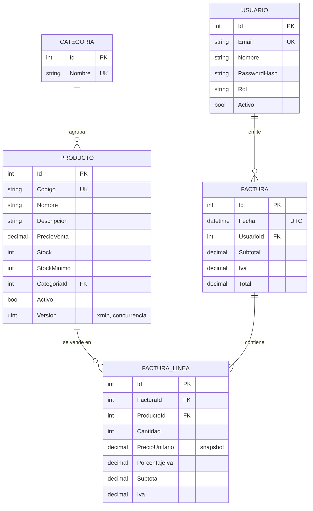

# FerreAPI

[](https://github.com/maxin7399/FerreAPI/actions/workflows/ci.yml)

API REST para la gestión de inventario y facturación de una ferretería, construida con **ASP.NET Core (.NET 10)**, **Entity Framework Core** y **PostgreSQL**.

Permite administrar el catálogo de productos y categorías, registrar ventas con cálculo de IVA y descuento automático de inventario, y controlar el acceso por roles mediante JWT. El foco del proyecto está en modelar reglas de negocio reales y en garantizar la consistencia de los datos, incluso ante ventas simultáneas.

**API en vivo:** [documentación interactiva (Scalar)](https://ca-ferreapi.graymoss-88f7523c.eastus2.azurecontainerapps.io/scalar) · [estado](https://ca-ferreapi.graymoss-88f7523c.eastus2.azurecontainerapps.io/health/ready). Desplegada en Azure Container Apps; la primera petición después de un rato sin uso puede tardar unos segundos mientras la app y la base de datos arrancan.

## Funcionalidades

- **Catálogo:** productos y categorías con búsqueda, filtros y paginación.
- **Facturación:** ventas de varias líneas con cálculo de subtotal, IVA (19 %) y total; el inventario se descuenta de forma atómica.
- **Control de inventario:** el stock nunca puede quedar negativo, ni siquiera con ventas concurrentes.
- **Autenticación y autorización:** login con JWT y dos roles, `Administrador` y `Vendedor`.
- **Trazabilidad:** cada factura registra el usuario que la emitió; un vendedor solo puede consultar sus propias ventas.
- **Errores consistentes:** todas las respuestas de error siguen el estándar ProblemDetails (RFC 9457).
- **Health checks:** `/health/live` indica si el proceso está vivo, sin revisar dependencias; `/health/ready` verifica la conexión con PostgreSQL y responde `503` si la base de datos no está disponible.
- **Logging estructurado:** los eventos de negocio (factura creada, conflicto de inventario, inicio de sesión exitoso o fallido) se registran con `[LoggerMessage]`, con campos consultables y un `EventId` fijo por módulo (1xxx autenticación, 2xxx facturación).

## Stack

| Área | Tecnología |
|---|---|
| Framework | ASP.NET Core 10 · Minimal APIs |
| Persistencia | Entity Framework Core 10 · PostgreSQL (Npgsql) |
| Seguridad | JWT Bearer · `PasswordHasher` (PBKDF2 con sal) · políticas de autorización por rol |
| Documentación | OpenAPI · Scalar |
| Pruebas | xUnit · `WebApplicationFactory` · Testcontainers |
| Contenedores | Docker (build multi-stage) · Docker Compose |
| CI/CD y nube | GitHub Actions · GitHub Container Registry · Azure Container Apps · Neon (PostgreSQL) |

## Modelo de datos



## Decisiones de diseño

**Reglas de negocio en el dominio.** El stock solo se modifica mediante `DescontarStock` y `AumentarStock`, que validan la operación. La factura se comporta como un agregado: la única forma de agregarle una línea es `AgregarLinea`, que valida el producto, descuenta el stock, toma el precio vigente y recalcula los totales en un solo paso. Desde fuera es imposible construir una factura con totales inconsistentes.

**Snapshot de precios.** Cada línea guarda el precio unitario y el porcentaje de IVA vigentes al momento de la venta. Si un producto cambia de precio, las facturas emitidas no se alteran.

**Concurrencia optimista.** Los productos usan la columna de sistema `xmin` de PostgreSQL como token de concurrencia. Si dos ventas intentan descontar el mismo stock al mismo tiempo, una se confirma y la otra se rechaza con `409 Conflict`. La factura, sus líneas y la actualización del inventario se guardan en una única transacción.

**Unicidad garantizada por la base de datos.** Los códigos de producto, los nombres de categoría y los emails de usuario tienen índices únicos. La API verifica duplicados antes de insertar, pero la garantía real la da el índice, que cubre también las peticiones simultáneas.

**Borrado lógico.** Productos y usuarios no se eliminan físicamente, se desactivan. Así se conserva la integridad del historial de facturas.

**Inactivos con filtro explícito.** Los listados excluyen los productos desactivados con el método `Activos()`, en lugar de un filtro global de EF Core (`HasQueryFilter`). Un filtro global se aplicaría también al cargar las líneas de facturas antiguas y ocultaría los productos que ya no se venden; con el filtro explícito, cada consulta deja ver qué datos trae.

**Validación en dos capas.** La forma de la petición (campos obligatorios, longitudes, rangos, productos repetidos en una factura) se valida de forma declarativa con atributos e `IValidatableObject`, mediante la validación integrada de .NET 10, antes de que se ejecute el handler. El estado del negocio (que el producto exista, esté activo y tenga stock, o que un código no esté repetido) se valida en el handler, porque necesita consultar la base de datos. Las dos capas responden con el mismo `400` en formato ProblemDetails.

**Redondeo contable.** El IVA se redondea con `MidpointRounding.AwayFromZero` (0,285 → 0,29), en lugar del redondeo bancario que .NET aplica por defecto.

**Seguridad por defecto.** Una política de autorización de respaldo exige autenticación en todo endpoint que no declare otra regla; lo público se abre de forma explícita. El login devuelve el mismo mensaje ante cualquier fallo para evitar la enumeración de usuarios, y una factura ajena responde `404` en lugar de `403` para no revelar su existencia.

**Migraciones separadas de la API.** En Docker, las migraciones se aplican con un bundle de EF Core en un servicio propio que corre una vez antes de la API, en lugar de llamar a `MigrateAsync()` al arrancar. Así varias réplicas de la API no compiten por migrar la base, la API no necesita permisos para modificar el esquema y, si una migración falla, la API no llega a arrancar.

**Rendimiento.** La facturación carga todos los productos en una sola consulta (sin N+1), las consultas de solo lectura usan `AsNoTracking` y el listado de facturas usa proyecciones para traer únicamente las columnas necesarias.

## Endpoints

| Método | Ruta | Descripción | Acceso |
|---|---|---|---|
| `POST` | `/api/auth/login` | Inicia sesión y devuelve un JWT | Público |
| `GET` | `/api/productos` | Lista productos (`busqueda`, `categoriaId`, `pagina`, `tamanio`) | Vendedor, Administrador |
| `GET` | `/api/productos/{id}` | Consulta un producto | Vendedor, Administrador |
| `POST` | `/api/productos` | Crea un producto | Administrador |
| `PUT` | `/api/productos/{id}` | Actualiza un producto | Administrador |
| `DELETE` | `/api/productos/{id}` | Desactiva un producto | Administrador |
| `GET` | `/api/categorias` | Lista categorías | Vendedor, Administrador |
| `GET` | `/api/categorias/{id}` | Consulta una categoría | Vendedor, Administrador |
| `POST` | `/api/categorias` | Crea una categoría | Administrador |
| `GET` | `/api/facturas` | Lista facturas paginadas (el vendedor ve solo las suyas) | Vendedor, Administrador |
| `GET` | `/api/facturas/{id}` | Consulta una factura con sus líneas | Vendedor, Administrador |
| `POST` | `/api/facturas` | Registra una venta | Vendedor, Administrador |
| `GET` | `/api/usuarios` | Lista usuarios | Administrador |
| `POST` | `/api/usuarios` | Crea un usuario | Administrador |
| `DELETE` | `/api/usuarios/{id}` | Desactiva un usuario | Administrador |
| `GET` | `/health/live` | Liveness: el proceso responde | Público |
| `GET` | `/health/ready` | Readiness: la base de datos está disponible | Público |

En entorno de desarrollo, la documentación interactiva está disponible en `/scalar`.

## Ejecución con Docker

La forma más rápida de levantar el proyecto. Solo requiere [Docker](https://www.docker.com/).

```bash
cp .env.example .env    # y reemplaza los valores
docker compose up --build
```

Compose levanta tres servicios en orden:

1. **`db`**: PostgreSQL con un volumen persistente. Los demás esperan a que su healthcheck confirme que acepta conexiones.
2. **`migraciones`**: un bundle de EF Core que aplica las migraciones pendientes y termina.
3. **`api`**: arranca solo si las migraciones terminaron bien. Queda disponible en `http://localhost:8080` (la documentación, en `/scalar`).

Los secretos se leen del archivo `.env`, que está excluido del repositorio. Para borrar también los datos: `docker compose down -v`.

## Ejecución local

### Requisitos

- [.NET 10 SDK](https://dotnet.microsoft.com/download)
- PostgreSQL
- [Docker](https://www.docker.com/) (solo para las pruebas de integración)
- Herramienta de EF Core: `dotnet tool install --global dotnet-ef`

### Configuración

Los datos sensibles se manejan con User Secrets y nunca se guardan en el repositorio:

```bash
cd src/FerreAPI
dotnet user-secrets set "ConnectionStrings:FerreApi" "Host=localhost;Port=5432;Database=ferreapi;Username=postgres;Password=<tu_contraseña>"
dotnet user-secrets set "Jwt:Clave" "<clave_aleatoria_de_al_menos_32_bytes>"
dotnet user-secrets set "AdminInicial:Email" "admin@ferreapi.local"
dotnet user-secrets set "AdminInicial:Password" "<contraseña_del_administrador>"
```

Al iniciar por primera vez con la tabla de usuarios vacía, la API crea el administrador inicial con estas credenciales.

### Base de datos y arranque

```bash
dotnet ef database update --project src/FerreAPI
dotnet run --project src/FerreAPI
```

## Pruebas

```bash
dotnet test
```

- **Unitarias:** cubren las reglas del dominio: descuento de stock, cálculo de totales e IVA, redondeo y snapshot de precios.
- **De integración:** levantan la API completa contra un PostgreSQL desechable creado con Testcontainers y verifican autenticación (401), autorización (403), unicidad (409), aislamiento entre vendedores (404) y que las ventas simultáneas nunca vendan más que el stock disponible.

Docker debe estar en ejecución para correr las pruebas de integración.

**Integración continua:** en cada Pull Request y en cada cambio a `main`, GitHub Actions compila la solución (con las advertencias tratadas como errores), ejecuta todas las pruebas y verifica que las imágenes de Docker se construyan.

## Despliegue

Cada cambio que llega a `main` se despliega automáticamente, solo si la compilación y las pruebas pasaron:

```
merge a main ─▶ CI en verde ─▶ imágenes a ghcr.io (etiquetadas con el SHA del commit)
             ─▶ migraciones en Neon ─▶ nueva revisión en Azure Container Apps ─▶ verificación de /health/ready
```

- **Sin contraseñas de Azure en GitHub:** el pipeline se autentica con OIDC, mediante una credencial federada que solo acepta la rama `main` de este repositorio, y tiene permisos de Contributor únicamente sobre el grupo de recursos del proyecto.
- **Migraciones con conexión directa:** la API se conecta a Neon a través de su pooler (PgBouncer), pero las migraciones usan una conexión directa, porque el bloqueo de migraciones de EF Core necesita mantener la misma sesión.
- **Probes de salud:** Azure usa `/health/live` para el arranque (startup) y la vida del contenedor (liveness), y `/health/ready` para decidir cuándo enviarle tráfico (readiness). Una revisión nueva solo recibe peticiones cuando su readiness pasa, así que los despliegues no interrumpen el servicio.
- **Secretos fuera del código:** la cadena de conexión, la clave JWT y la contraseña del administrador viven como secretos de Container Apps y llegan a la API como variables de entorno.
- **Costo cero:** la app escala a cero réplicas cuando no recibe tráfico, y la base de datos usa el plan gratuito de Neon.

## Estructura

```
FerreAPI/
├── src/FerreAPI/
│   ├── Auth/          Login, generación de JWT y políticas
│   ├── Categorias/
│   ├── Comun/         Paginación, excepciones de negocio y manejo global de errores
│   ├── Data/          DbContext
│   ├── Facturas/
│   ├── Migrations/
│   ├── Productos/
│   └── Usuarios/
└── tests/FerreAPI.Tests/
    ├── Facturas/      Pruebas unitarias
    ├── Productos/     Pruebas unitarias
    └── Integracion/   Pruebas de integración
```

El código se organiza por funcionalidad: cada carpeta agrupa su entidad, sus DTOs y sus endpoints.

## Próximos pasos

- Frontend web que consuma la API.
- Revocar el acceso de un usuario desactivado aunque su token siga vigente.
